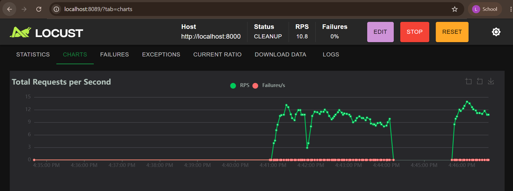

# Spoken-Word Recognition: an end-to-end MLOps pipeline

Voice-controlled apps only work if they understand what people say. In this project I built a system that recognises
eight short spoken words (*yes, no, up, down, left, right, stop, go*). It goes through the whole machine learning cycle:
getting the data, preprocessing, building and testing models, retraining (with a trigger), an API, a web UI, Docker and
load testing.

I first planned to do this with Kinyarwanda words, but I could not collect enough recordings in time, so I used the public
Google Speech Commands dataset instead. The same pipeline can be retrained on Kinyarwanda later by swapping in new recordings.

| | |
|---|---|
| 🎥 **Video demo (YouTube)** | https://youtu.be/XAbA7DbaA7o (camera on: prediction, upload, retrain, Locust) |
| 🌐 **Run the UI (Docker)** | `docker compose up --build -d`, then open http://localhost:8501 |
| 🔌 **API + Swagger docs** | http://localhost:8000/docs (after starting with Docker) |
| 💻 **GitHub repo** | https://github.com/Queenlinda12/spoken-word-mlops |

> The whole project is Dockerized (API, nginx load balancer and UI), so it runs the same way on any computer with Docker.
> See "Run with Docker" below. The first prediction after start-up is slow (about 40 seconds) because the model is still
> loading. After that it is fast.

## Project description

* **Data:** sound files (.wav) from [Google Speech Commands v0.02](https://arxiv.org/abs/1804.03209) (public, CC BY 4.0).
  I used 8 words and 40 speakers for the main dataset, plus 6 other speakers kept aside for the retraining demo.
* **Classes:** `yes, no, up, down, left, right, stop, go`. The class names are simply the folder names in `raw_recordings/`.
* **Preprocessing:** convert to mono 16 kHz, trim the silence, place the word in a 2 second window, turn it into a
  128×128 log-mel spectrogram, and scale it to the range [-1, 1].
* **Models I compared:** a plain CNN as the baseline, MobileNetV2 with transfer learning, and a regularised CNN. I picked the
  best one using the **validation** F1 score and only used the test set to report the final result. The regularised CNN won,
  so the saved file `models/spoken_words_mobilenetv2.h5` actually holds the regularised CNN (I kept the file name so the
  code did not need to change).
* **Optimisation:** dropout, L2 regularisation, batch normalisation, the Adam optimiser, early stopping, learning-rate
  reduction, class weights, audio augmentation (time shift, gain, speed, pitch, noise) and SpecAugment. MobileNetV2 was
  trained in two stages (head first, then fine-tuning).
* **Fair testing:** whole speakers are held out, so the test set and the validation set only contain voices the model never
  saw during training.
* **Metrics:** accuracy, loss, precision, recall, F1 (weighted and macro), ROC-AUC and a confusion matrix.
* **Retraining:** uploaded or recorded clips are checked (they must be real audio, not silence), saved in
  `data/train/<word>/` and logged in a SQLite database (`data/app.db`). Retraining loads the saved model as the
  pre-trained model, fine-tunes it on the larger dataset (learning rate 1e-5) and saves a new version. The previous version
  is kept as `*_prev.h5`. Retraining starts when you press the **Retrain** button, or automatically when
  `RETRAIN_THRESHOLD` (30 by default) new clips are waiting.

## Results (model version 2, test speakers the model never heard)

| Accuracy | Loss | Precision | Recall | F1 (weighted) |
|---|---|---|---|---|
| 0.780 | 0.737 | 0.808 | 0.780 | 0.783 |

The full tables (validation vs test, per-class report, confusion matrix, retraining before and after) are in the notebook.

> **A note on the numbers:** neural network training has some randomness, so every run of the notebook gives slightly
> different results. The table above comes from the run whose model is deployed in the app (`models/`). The outputs saved
> in the notebook on GitHub come from an earlier run of the same notebook (regularised CNN: test accuracy 0.770, F1 0.773).
> The regularised CNN won on validation in both runs, and the data, split and code are the same.

## Repository layout

```
spoken-word-mlops/
├── README.md
├── notebook/kinyarwanda_voice_mlops.ipynb   # preprocessing, training, evaluation, prediction, retrain demo
├── src/
│   ├── preprocessing.py   # data acquisition, audio preprocessing + augmentation, uploads database, data insights
│   ├── model.py           # build, train, evaluate, retrain, background jobs
│   └── prediction.py      # predict one clip (reloads the model when a new version is saved)
├── api/main.py            # FastAPI: /health /status /predict /upload /train /retrain /insights /runs
├── ui/app.py              # Streamlit UI (up-time, predict, visualisations, upload, train/retrain)
├── locustfile.py          # load test
├── scripts/               # prepare_speech_commands.py, check_recordings.py, prepare_dataset.py, convert_to_wav.sh,
│                          # run_flood_tests.sh, summarize_locust.py
├── Dockerfile, ui/Dockerfile, docker-compose.yml, nginx.conf
├── data/train/ data/test/ # <word>/<speaker>__<id>.wav
└── models/                # spoken_words_mobilenetv2.h5, class_names.json, metrics.json
```

## Step 0: get the data (no recording needed)

```bash
python scripts/prepare_speech_commands.py      # downloads Speech Commands (about 2.3 GB) and builds raw_recordings/ and new_recordings/
python scripts/check_recordings.py raw_recordings
```

* `raw_recordings/<word>/<speaker>__<n>.wav` is the main dataset (40 speakers, up to 3 clips per speaker per word).
* `new_recordings/<word>/<speaker>__<n>.wav` has 6 different speakers. I use them for the retraining demo and the bulk-upload demo.
* To use other words: `WORDS="yes,no,stop" python scripts/prepare_speech_commands.py`.
* To use your own recordings, put them in the same folder layout (speaker name, double underscore, number).

## Setup

### 1. Build the dataset and train the first model

```bash
git clone https://github.com/Queenlinda12/spoken-word-mlops.git && cd spoken-word-mlops
pip install -r requirements.txt
jupyter notebook notebook/kinyarwanda_voice_mlops.ipynb      # run all cells (Google Colab with a GPU also works)
```

The notebook creates `data/train` and `data/test`, trains and compares the models, and saves the best one in `models/`.
Without the notebook: `python scripts/prepare_dataset.py raw_recordings && python -c "from src import model; model.train()"`
(set `MODEL_ARCH=cnn` to train the small CNN instead of MobileNetV2).

### 2. Run with Docker (API + UI + load balancer)

The `models/` and `data/train/` folders must be present (they are already in this repo). Then:

```bash
docker compose up --build -d
# UI: http://localhost:8501      API docs: http://localhost:8000/docs
docker compose up -d --scale api=3 && docker compose restart lb      # run 3 API containers
docker compose down                                                    # stop everything
```

If the UI says "API is DOWN", wait about a minute for the model to load and then run `docker compose restart lb`.
Retraining runs in the background and can take 10 to 30 minutes on a laptop CPU, so please do not restart the containers
while it is running. Use only the **Retrain** button. The "Train first model" button trains MobileNetV2 from scratch and
replaces the saved model.

### 3. Run without Docker

```bash
python -m uvicorn api.main:app --port 8000                          # terminal 1
pip install -r ui/requirements.txt
API_URL=http://localhost:8000 streamlit run ui/app.py               # terminal 2
```

### API endpoints

| Method | Path | What it does |
|---|---|---|
| GET | `/health` | checks that the API is alive |
| GET | `/status` | up-time, model version, test metrics, training state, pending uploads |
| POST | `/predict` | one audio clip in, predicted word + confidence + probabilities out |
| POST | `/upload` | many clips + `label` + `speaker`, saved and logged (starts retraining at the threshold) |
| POST | `/train` / `/retrain` | start the first training / a retraining (in the background) |
| GET | `/insights` | class balance, 3 acoustic features, spectrograms and interpretations |
| GET | `/runs` | training history from the database |

## Flood request simulation (Locust)

```bash
bash scripts/run_flood_tests.sh 100 10 60s    # 100 users, 10 new users per second, 60 s, on 1, 2 and 3 API containers
python scripts/summarize_locust.py            # prints the markdown table below
```

You can also run it interactively: `locust -f locustfile.py --host http://localhost:8000` and open http://localhost:8089.

**Results (100 users, 60 seconds, through the nginx load balancer):**

| API containers | Requests | Failures | Avg (ms) | Median (ms) | p95 (ms) | Max (ms) | Req/s |
|---|---|---|---|---|---|---|---|
| 1 | 284 | 0 | 14282 | 13000 | 24000 | 25999 | 4.90 |
| 2 | 99 | 0 | 4063 | 4800 | 6700 | 7544 | 4.17 |
| 3 | 200 | 0 | 4435 | 4400 | 8200 | 8930 | 5.79 |

Each row adds up `POST /predict`, `GET /status` and `GET /health`. The raw CSV files are in `results/`.



*Charts from the Locust web UI in a separate interactive run (3 API containers, 100 users, 60 s). The small first bump is
a 10-user trial run and the second one is the 100-user run. The exact numbers are a bit different from the table above,
which comes from the scripted run.*

**What I saw:** no request failed in any run. Going from 1 container to 2 or 3 brought the average response time down from
about 14.3 s to about 4.1 to 4.4 s, and the p95 from 24 s to between 6.7 and 8.2 s. This is because the load balancer
shares the predictions between the containers instead of making them queue in one. The number of requests per second only
went up a little, because the load generator, nginx and all the containers run on the same laptop and share its CPU. On
separate servers, more containers would give a bigger gain in throughput.

## Limitations

The vocabulary is small, there are only a limited number of voices and microphones, and most recordings were made in quiet
rooms. Next steps: more speakers (children and adults), background-noise augmentation, more words, hosting in the cloud
behind HTTPS (browser microphone recording needs HTTPS or localhost), and a "please repeat" message when the confidence is low.
